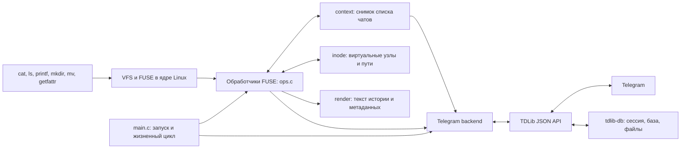
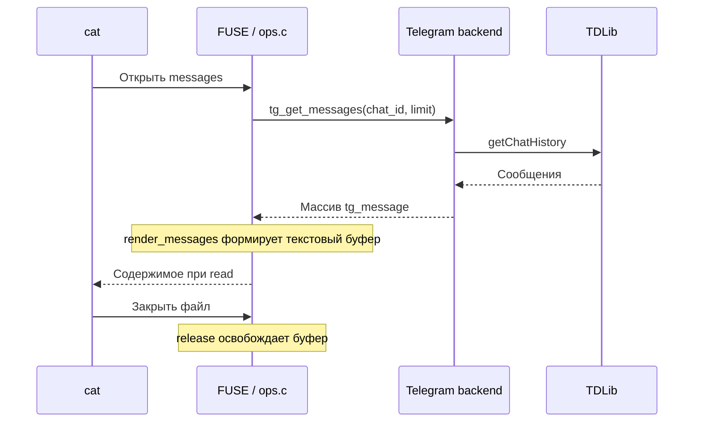
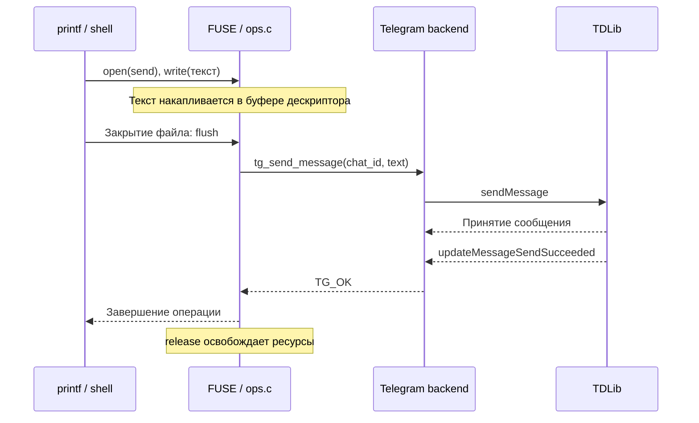

# TGFS — файловая система для Telegram

Лабораторная работа №3 по технологии FUSE.

- Выполнил: Чимирев Антон Олегович.
- Направление: нейротехнологии и программирование.
- Группа: P3322.

TGFS представляет Telegram-аккаунт в виде виртуальной файловой системы. После
авторизации пользователь получает каталог с личными диалогами, группами,
каналами и архивом. С чатами можно работать обычными консольными командами:
читать переписку через `cat`, отправлять сообщения записью в файл, создавать
группы через `mkdir`, менять названия и архивировать чаты через `mv`.

Проект написан на C11. Работа с файловой системой реализована через
низкоуровневый API libfuse3, взаимодействие с Telegram — через JSON-интерфейс TDLib.
Используется пользовательский аккаунт Telegram; токен бота для запуска не нужен.

## Оглавление

1. [Назначение и возможности](#1-назначение-и-возможности)
2. [Требования и зависимости](#2-требования-и-зависимости)
3. [Установка зависимостей](#3-установка-зависимостей)
4. [Сборка проекта](#4-сборка-проекта)
5. [Настройка и запуск](#5-настройка-и-запуск)
6. [Структура виртуальной файловой системы](#6-структура-виртуальной-файловой-системы)
7. [Работа с Telegram через файлы](#7-работа-с-telegram-через-файлы)
8. [Расширенные атрибуты](#8-расширенные-атрибуты)
9. [Архитектура](#9-архитектура)
10. [Структура репозитория](#10-структура-репозитория)
11. [Программный интерфейс backend](#11-программный-интерфейс-backend)
12. [Разработка и проверка](#12-разработка-и-проверка)
13. [Материалы](#13-материалы)

## 1. Назначение и возможности

Проект демонстрирует, как представить внешний сервис через интерфейс файловой
системы, работающей в пространстве пользователя. Виртуальные файлы не являются
обычными файлами на диске: чтение и запись преобразуются в операции Telegram.

| Возможность | Интерфейс файловой системы |
| --- | --- |
| Просмотр личных диалогов, групп и каналов | Каталоги `users`, `groups`, `channels` |
| Просмотр архивных чатов | Каталог `archive` |
| Чтение последних сообщений | Файл `messages` |
| Чтение одного сообщения | Файлы `messages_files/<message_id>.txt` |
| Отправка текста | Запись в `send` |
| Просмотр сведений о чате | Файл `info` |
| Открытие личного диалога по username | Запись в `users/add` |
| Просмотр и сохранение фотографий | Файлы `media/<message_id>.jpg` |
| Создание супергруппы или канала | `mkdir` внутри `groups` или `channels` |
| Изменение названия группы или канала | Переименование каталога через `mv` |
| Архивирование и извлечение из архива | Перенос каталога через `mv` |
| Просмотр участников группы | Каталог `members` |
| Добавление участника | `mkdir` с числовым user_id внутри `members` |
| Исключение участника | `rmdir` для каталога участника |
| Работа с личным диалогом участника | Файлы внутри его каталога |
| Чтение метаданных и управление уведомлениями | Расширенные атрибуты каталога чата |

Операции записи выполняются в авторизованном аккаунте и изменяют данные в Telegram.
Доступность отправки сообщений и управления чатами определяется правами этого
аккаунта в соответствующем диалоге, группе или канале.

## 2. Требования и зависимости

Инструкции ниже предназначены для Linux; команды установки пакетов приведены
для Debian/Ubuntu. Для монтирования необходимы поддержка FUSE в ядре и доступ
к устройству `/dev/fuse`.

| Компонент | Назначение |
| --- | --- |
| GCC или Clang с поддержкой C11 | Компиляция TGFS |
| CMake 3.16 или новее | Конфигурация и сборка проекта |
| Make или Ninja | Выполнение сборки, сгенерированной CMake |
| pkg-config | Поиск libfuse3 через пакет `fuse3` |
| libfuse3 и заголовочные файлы | Низкоуровневый API FUSE; проект задаёт `FUSE_USE_VERSION=31` |
| TDLib с заголовками и CMake-пакетом `Td` | Работа с Telegram через библиотеку `Td::TdJson` |
| POSIX Threads | Фоновое получение ответов и обновлений TDLib |
| Утилиты `fusermount3`, `getfattr`, `setfattr` | Размонтирование и работа с расширенными атрибутами |
| Аккаунт Telegram, API ID и API hash | Авторизация клиента |
| Интернет | Подключение к Telegram |

Для самостоятельной сборки TDLib дополнительно нужны компилятор C++17,
OpenSSL, zlib и gperf. Требования TDLib и варианты установки приведены в её
[официальной документации](https://github.com/tdlib/td#dependencies).

Библиотеки **cJSON** и **uthash** включены в каталог `third_party`, отдельно
устанавливать их для TGFS не требуется. Версия TDLib в CMake проекта не закреплена.

## 3. Установка зависимостей

### 3.1. Системные пакеты

```bash
sudo apt update
sudo apt install -y \
  build-essential cmake pkg-config git \
  fuse3 libfuse3-dev attr \
  gperf libssl-dev zlib1g-dev
```

Проверить установленные инструменты можно командами:

```bash
cc --version
cmake --version
pkg-config --modversion fuse3
fusermount3 --version
```

### 3.2. TDLib

Если TDLib уже установлена с CMake-пакетом `Td`, переходите к сборке TGFS.
Иначе её можно собрать отдельно и установить в пользовательский каталог:

```bash
mkdir -p "$HOME/.cache/tgfs"
git clone https://github.com/tdlib/td.git "$HOME/.cache/tgfs/td"

cmake -S "$HOME/.cache/tgfs/td" -B "$HOME/.cache/tgfs/td/build" \
  -DCMAKE_BUILD_TYPE=Release \
  -DCMAKE_INSTALL_PREFIX="$HOME/.local/opt/tdlib"

cmake --build "$HOME/.cache/tgfs/td/build" --parallel 2
cmake --install "$HOME/.cache/tgfs/td/build"
```

Каталог установки понадобится в параметре `CMAKE_PREFIX_PATH` при конфигурации
TGFS. Для другой системы или конфигурации доступен официальный
[генератор инструкций сборки TDLib](https://tdlib.github.io/td/build.html).

## 4. Сборка проекта

Все дальнейшие команды выполняются из каталога проекта, где находится
`CMakeLists.txt` — в этом репозитории это `lab/fuse`.

### 4.1. Сборка для разработки

```bash
cmake -S . -B build \
  -DCMAKE_BUILD_TYPE=Debug \
  -DCMAKE_PREFIX_PATH="$HOME/.local/opt/tdlib"

cmake --build build --parallel 2
```

Результат — исполняемый файл `build/tgfs`.

Если TDLib установлена в стандартный системный каталог и CMake находит её
автоматически, параметр `CMAKE_PREFIX_PATH` можно опустить. Также можно передать
`-DTd_DIR=/путь/к/каталогу/с/TdConfig.cmake`, указав непосредственно каталог
CMake-пакета TDLib.

### 4.2. Оптимизированная сборка

```bash
cmake -S . -B build-release \
  -DCMAKE_BUILD_TYPE=Release \
  -DCMAKE_PREFIX_PATH="$HOME/.local/opt/tdlib"

cmake --build build-release --parallel 2
```

Для запуска используется `build-release/tgfs`. Отдельного режима сервера или
команды деплоя нет: приложение запускается на Linux-машине, где будет доступна
точка монтирования. При переносе бинарного файла на другую машину там также
должны быть доступны его динамические зависимости, включая TDLib и libfuse3.

CMake собирает одну цель `tgfs`. Выбор альтернативного backend не требуется:
в текущей сборке используется TDLib.

## 5. Настройка и запуск

### 5.1. API ID и API hash

Получите параметры приложения в разделе **API development tools** на
[my.telegram.org](https://my.telegram.org). Перед запуском задайте переменные
окружения:

```bash
export TG_API_ID='123456'
export TG_API_HASH='ваш_api_hash'
```

Замените значения своими. `TG_API_ID` должен быть положительным числом,
`TG_API_HASH` — строкой, выданной Telegram. Оба значения нужно задать до запуска.

Программа читает переменные окружения процесса. Конфигурацию можно хранить
в локальном файле `.tgfs_env` с командами `export`, загружая его самостоятельно:

```bash
source .tgfs_env
```

Этот файл добавлен в `../../os-course/lab/fuse/.gitignore`; автоматического чтения `.env` при запуске нет.

### 5.2. Монтирование

Создайте пустой каталог и запустите приложение:

```bash
mkdir -p mnt
./build/tgfs -f -o limit=100 mnt
```

Для Release-сборки замените путь на `./build-release/tgfs`.

| Параметр | Назначение |
| --- | --- |
| `mnt` | Существующий каталог, который станет точкой монтирования |
| `-f` | Запуск в переднем плане, удобный для интерактивной авторизации |
| `-o limit=100` | Глубина истории и лимит выдачи участников |
| `-d` | Диагностический вывод FUSE при разработке |

`limit` задавайте явно положительным числом. Это количество последних сообщений,
из которых формируются `messages`, `messages_files` и список фотографий в `media`.
Для `media` ограничивается число просмотренных сообщений, а не число фотографий.
Этот же параметр используется при запросах участников группы.

Приложение работает до завершения процесса. Пока оно запущено в первом
терминале, открывайте второй терминал для работы с содержимым `mnt`.

### 5.3. Авторизация и локальная сессия

Перед монтированием TDLib выполняет авторизацию. В зависимости от состояния
аккаунта программа запрашивает номер телефона, код из Telegram, пароль 2FA,
адрес электронной почты или код из письма. Если требуется подтверждение
на другом устройстве, в терминале выводится ссылка.

Локальная база TDLib хранится в каталоге `tdlib-db` относительно рабочего
каталога процесса. Загруженные файлы размещаются в `tdlib-db/files`. При
следующем запуске из того же рабочего каталога используется сохранённая сессия.
Приложение предназначено для входа в существующий аккаунт.

`TG_API_HASH`, файлы конфигурации и `tdlib-db` содержат приватные данные.
Каталоги сессии и локальная конфигурация исключены из Git через `../../os-course/lab/fuse/.gitignore`.
Завершение TGFS закрывает клиент, сохраняя данные сессии для следующего запуска.

### 5.4. Завершение работы

Во втором терминале, из корня проекта:

```bash
fusermount3 -u mnt
```

Также можно нажать `Ctrl+C` в терминале, где работает TGFS. При штатном
завершении программа размонтирует файловую систему и освобождает ресурсы.

## 6. Структура виртуальной файловой системы

Пример дерева после монтирования:

```text
mnt/
├── users/                             # Личные диалоги
│   ├── add                            # Открытие диалога по username
│   └── Ivan_Petrov/
│       ├── info                       # Сведения о диалоге
│       ├── messages                   # Последние сообщения одним текстом
│       ├── send                       # Отправка текста
│       ├── messages_files/
│       │   └── 123456789.txt           # Отдельное сообщение
│       └── media/
│           └── 123456790.jpg           # Фотография из сообщения
├── groups/                            # Обычные группы и супергруппы
│   └── Study_Group/
│       ├── info
│       ├── messages
│       ├── send
│       ├── messages_files/
│       ├── media/
│       └── members/                   # Участники группы
│           └── Ivan_Petrov/
│               ├── info
│               ├── messages
│               ├── send
│               ├── messages_files/
│               └── media/
├── channels/                          # Каналы
│   └── News/
│       ├── info
│       ├── messages
│       ├── send
│       ├── messages_files/
│       └── media/
└── archive/                           # Архивные чаты всех типов
    └── Old_Group/
        ├── info
        ├── messages
        ├── send
        ├── messages_files/
        ├── media/
        └── members/
```

Имена чатов и участников формируются из первых двух слов названия или имени:
пробел между ними заменяется на `_`. Например, `Study Group Discussion`
отображается как `Study_Group`. Для команд используйте фактические имена из `ls`.
Числовые имена файлов в `messages_files` и `media` — идентификаторы сообщений.

Архивный чат отображается в `archive` вместо основной категории. Его содержимое
сохраняет структуру исходного типа: например, у архивной группы есть `members`.

### Права доступа

| Объект | Права | Назначение |
| --- | --- | --- |
| Корень, `media`, `messages_files`, каталог участника | `0555` | Просмотр и переход по каталогам |
| Категории, каталог чата, `members` | `0755` | Навигация и предусмотренные операции управления |
| `info`, `messages`, отдельные сообщения и фотографии | `0444` | Чтение |
| `send` в доступном для записи чате | `0200` | Отправка от имени владельца монтирования |
| `send` в чате без права отправки | `0444` | Отправка недоступна |
| `users/add` | `0200` | Запись username |

Владельцем виртуальных объектов выступает пользователь, запустивший TGFS.
Приложение добавляет опцию `default_permissions`, чтобы ядро проверяло
права доступа по атрибутам файлов.

## 7. Работа с Telegram через файлы

В примерах предполагается, что точка монтирования — `mnt`. Названия чатов,
username и числовые ID заменяйте своими значениями.

### 7.1. Просмотр чатов

```bash
ls mnt
ls mnt/users
ls mnt/groups
ls mnt/channels
ls mnt/archive
```

Список чатов перечитывается при обращении к категориям. Личные диалоги
включают доступные пользовательскому аккаунту беседы; группы и супергруппы
представлены вместе в `groups`.

### 7.2. Информация о чате

```bash
cat mnt/groups/Study_Group/info
cat mnt/users/Ivan_Petrov/info
```

Пример содержимого `info` для группы:

```text
title: Study Group
type: group
username: none
members: 15
unread: 3
writable: yes
```

| Поле | Значение |
| --- | --- |
| `title` | Полное название чата |
| `type` | `user`, `group` или `channel` |
| `username` | Публичный username либо `none` |
| `members` | Число участников; `0`, если значение неизвестно или неприменимо |
| `user_id` | Идентификатор пользователя; выводится для личных диалогов |
| `unread` | Количество непрочитанных сообщений |
| `writable` | Возможность отправки сообщений: `yes` или `no` |

### 7.3. История сообщений

```bash
cat mnt/groups/Study_Group/messages
less mnt/groups/Study_Group/messages
```

История отображается в хронологическом порядке, от старых сообщений к новым.
Каждая запись содержит дату, время, отправителя и текст:

```text
[2026-11-17 10:30] Ivan Petrov: Привет!
[2026-11-17 10:31] Антон: Доброе утро!
```

Время форматируется в локальном часовом поясе процесса. Нетекстовое содержимое
отображается обозначениями вроде `[фото]`, `[стикер]`, `[видео]`; при наличии
подписи она включается в текстовое представление. При пустой истории выводится
`нет сообщений`.

Текст формируется при открытии файла и используется до его закрытия. Чтобы
получить следующую выборку сообщений, откройте файл повторно.

Отдельные сообщения доступны по ID:

```bash
ls mnt/groups/Study_Group/messages_files
cat mnt/groups/Study_Group/messages_files/123456789.txt
```

`messages` и `messages_files` представляют последние сообщения в пределах
заданного `limit`.

### 7.4. Отправка сообщений

```bash
printf '%s' 'Привет!' >> mnt/users/Ivan_Petrov/send
printf '%s' 'Сообщение для группы' >> mnt/groups/Study_Group/send
printf 'Первая строка\nВторая строка' >> mnt/groups/Study_Group/send
```

Записи в открытый `send` накапливаются в памяти. При закрытии дескриптора
обработчик `flush` передаёт накопленный текст в Telegram. В обычном сценарии
одно открытие и закрытие файла соответствует одному сообщению. Несколько
строк можно отправить одним сообщением.

В примерах используется `>>` для открытия существующего служебного файла
на запись без усечения. `printf` позволяет явно управлять переводами строк;
`echo` добавляет перевод строки в конец текста.

В каналы можно публиковать сообщения, если аккаунт имеет соответствующие
права. Backend ожидает подтверждения отправки от TDLib перед завершением
операции.

### 7.5. Открытие диалога по username

```bash
printf '%s' '@username' >> mnt/users/add
ls mnt/users
```

Передавайте один username без пробелов и завершающего перевода строки.
Начальный символ `@` необязателен. Username должен принадлежать пользователю.

Операция открывает личный диалог и помещает его в основной список Telegram.
Если диалог находился в архиве, он извлекается из архива. Сообщение при этом
не отправляется, пользователь не добавляется в контакты.

### 7.6. Фотографии

```bash
ls mnt/groups/Study_Group/media
cp mnt/groups/Study_Group/media/123456790.jpg /tmp/tg-photo.jpg
```

В `media` представлены фотографии из последних `limit` сообщений. Для каждого
сообщения с фотографией выбирается один JPEG-вариант, близкий к 640 пикселям
по длинной стороне. Имя файла содержит ID сообщения.

При открытии фотографии TDLib загружает её в локальный кеш, после чего TGFS
читает полученный файл. В этот интерфейс входят фотографии сообщений;
видео, документы, аватары и превью ссылок в `media` не включаются.

### 7.7. Создание групп и каналов

```bash
mkdir mnt/groups/New_Group
mkdir mnt/channels/New_Channel
```

Создание каталога в `groups` создаёт супергруппу Telegram, а в `channels` —
канал. Переданное имя используется как название нового чата.

### 7.8. Переименование

```bash
mv -T mnt/groups/New_Group mnt/groups/Renamed_Group
mv -T mnt/channels/New_Channel mnt/channels/Renamed_Channel
```

Переименование каталога меняет название соответствующей группы или канала
в Telegram. Операция требует права изменять сведения о чате. Параметр `-T`
у GNU `mv` задаёт точный путь назначения.

После изменения названия проверьте фактическое имя каталога через `ls`:
к нему применяется общее правило формирования имён из первых двух слов.

### 7.9. Архивирование

```bash
mv -T mnt/groups/Study_Group mnt/archive/Study_Group
ls mnt/archive
```

Для возврата из архива переместите чат в категорию его исходного типа:

```bash
mv -T mnt/archive/Study_Group mnt/groups/Study_Group
```

Аналогично работают личные диалоги и каналы. При архивировании и извлечении
сохраняйте имя каталога. Каталог назначения определяет перемещение между
основным списком и архивом, а не изменение типа чата.

### 7.10. Участники группы

Просмотр состава группы:

```bash
ls mnt/groups/Study_Group/members
```

Для обычных групп backend получает состав группы, для супергрупп — участников
через фильтр `supergroupMembersFilterRecent`. Выдача ограничивается `limit`
и доступностью списка для текущего аккаунта.

Добавление участника выполняется по числовому **Telegram user_id**:

```bash
mkdir mnt/groups/Study_Group/members/123456789
ls mnt/groups/Study_Group/members
```

Пользователь должен быть известен TDLib, например из существующего диалога
или поиска по username. Добавление требует права приглашать участников
и учитывает настройки приватности пользователя. В выдаче `members` участник
представлен своим именем, поэтому после добавления используйте имя из `ls`.

Исключение выполняется по имени каталога участника:

```bash
rmdir mnt/groups/Study_Group/members/Ivan_Petrov
```

Операция исключает участника без бана и требует права управлять участниками.
Для неё используется `rmdir`, без рекурсивного удаления содержимого. Этот
интерфейс предназначен для исключения обычных участников, а не для выхода
из группы или изменения ролей администраторов.

В каталоге участника представлены `info`, `messages`, `send`, `messages_files`
и `media`. Эти файлы относятся к **личному диалогу с участником**. Например,
запись в его `send` отправляет личное сообщение:

```bash
printf '%s' 'Личное сообщение' >> mnt/groups/Study_Group/members/Ivan_Petrov/send
```

## 8. Расширенные атрибуты

Метаданные доступны у каталога самого чата. Для чтения и записи используются
утилиты из пакета `attr`:

```bash
getfattr -d mnt/groups/Study_Group
getfattr -n user.tg.unread mnt/groups/Study_Group
getfattr -n user.tg.writable mnt/groups/Study_Group
getfattr -n user.id mnt/users/Ivan_Petrov
```

| Атрибут | Значение | Доступ |
| --- | --- | --- |
| `user.tg.id` | Идентификатор чата Telegram; читается по явному имени | Чтение |
| `user.tg.unread` | Количество непрочитанных сообщений | Чтение |
| `user.tg.writable` | `1` — отправка разрешена, `0` — недоступна | Чтение |
| `user.id` | user_id для личного диалога, `0` для группы или канала | Чтение |
| `user.chat.notifications` | `1` — обычные уведомления отключены, `0` — включены | Чтение и запись |

Идентификатор чата можно запросить отдельно:

```bash
getfattr -n user.tg.id mnt/groups/Study_Group
```

Управление уведомлениями:

```bash
# Посмотреть текущее значение.
getfattr -n user.chat.notifications mnt/groups/Study_Group

# Отключить уведомления.
setfattr -n user.chat.notifications -v 1 mnt/groups/Study_Group

# Включить уведомления.
setfattr -n user.chat.notifications -v 0 mnt/groups/Study_Group
```

Значение атрибута — один символ `0` или `1`. Несмотря на слово `notifications`
в имени, значение соответствует флагу `muted`: **1 означает отключение**.
Чтение учитывает общие настройки Telegram, а запись задаёт индивидуальную
настройку обычных уведомлений для выбранного чата.

## 9. Архитектура

### 9.1. Основные компоненты



- **`main.c`** разбирает параметры, создаёт backend, выполняет авторизацию,
  загружает список чатов, создаёт и монтирует FUSE-сессию. После завершения
  цикла запросов освобождает ресурсы.
- **`ops.c`** связывает операции файловой системы с действиями Telegram.
  Здесь находятся обработчики чтения, записи, каталогов, переименования
  и расширенных атрибутов, а также буферы открытых файлов.
- **`context`** хранит backend, текущий массив чатов, время его обновления
  и заданный пользователем `limit`.
- **`inode`** отвечает за типы виртуальных узлов, номера inode, поиск по имени,
  формирование имён и атрибутов `stat`. Узлы индексируются через uthash
  по номеру inode и составному ключу объекта.
- **`render`** преобразует структуры сообщений и чатов в текст для файлов
  `messages`, отдельных сообщений и `info`.
- **`backend`** изолирует взаимодействие с Telegram. Он предоставляет
  синхронный C-интерфейс, скрывая JSON, запросы и внутренние структуры TDLib.

Внешние зависимости времени выполнения — Telegram и локальная TDLib.
Отдельные HTTP-сервер, СУБД или очередь сообщений проекту не нужны: хранением
локальных данных управляет TDLib.

### 9.2. Потоки и обновление данных

FUSE-запросы обрабатываются в цикле `fuse_session_loop`. Backend использует
отдельный поток, который вызывает `td_receive`, принимает ответы и обновления
и актуализирует внутренние таблицы пользователей и чатов.

Каждому запросу TDLib присваивается идентификатор `@extra`. Поток получения
сопоставляет ответ с ожидающим запросом, а вызывающий код дожидается результата
через mutex и condition variable. Благодаря этому асинхронный API TDLib
представлен для файловой системы как набор обычных синхронных функций.

Список чатов в `context` обновляется через `ctx_refresh_chats`, в частности
при просмотре категорий и выполнении управляющих операций. Имена и атрибуты
узлов кешируются FUSE на короткое время — в ответах задаётся одна секунда.
Для открытых файлов включается `direct_io`.

### 9.3. Чтение истории



Для фотографий вместо текстового буфера открывается загруженный TDLib файл,
а чтение выполняется через `pread`.

### 9.4. Отправка сообщения



Backend различает принятие сообщения в очередь и подтверждение отправки.
Ожидание обычного запроса ограничено 30 секундами; подтверждение отправки
и загрузка фотографии имеют отдельные интервалы ожидания до 60 секунд.

### 9.5. Соответствие команд обработчикам FUSE

| Действие | Основные обработчики |
| --- | --- |
| Поиск пути и получение атрибутов | `lookup`, `getattr` |
| Просмотр каталога | `readdir` |
| Чтение текста или фотографии | `open`, `read`, `release` |
| Отправка сообщения или открытие диалога через `add` | `open`, `write`, `flush`, `release` |
| Создание группы/канала или добавление участника | `mkdir` |
| Переименование, архивирование, извлечение | `rename` |
| Исключение участника | `rmdir` |
| Чтение расширенного атрибута | `getxattr` |
| Перечисление расширенных атрибутов | `listxattr` |
| Изменение уведомлений | `setxattr` |

Конкретная последовательность запросов зависит от утилиты и кеша ядра:
например, перед `open` могут выполняться `lookup` и `getattr`.

## 10. Структура репозитория

```text
lab/fuse/
├── CMakeLists.txt                 # Зависимости и сборка исполняемого файла tgfs
├── README.md                      # Документация проекта
├── TASK.md                        # Исходное задание лабораторной работы
├── .gitignore                     # Исключения для сборок, точки монтирования и сессии
├── src/
│   ├── main.c                     # Инициализация, авторизация и FUSE-сессия
│   ├── backend/
│   │   ├── tg_backend.h           # Публичные структуры и функции backend
│   │   └── tg_backend_tdlib.c     # Реализация Telegram через TDLib JSON API
│   └── fs/
│       ├── ops.h                  # Объявление таблицы операций FUSE
│       ├── ops.c                  # Обработчики запросов файловой системы
│       ├── context/
│       │   ├── ctx.h              # Контекст файловой системы
│       │   └── ctx.c              # Обновление и поиск чатов
│       ├── inode/
│       │   ├── inode.h            # Типы и интерфейс виртуальных узлов
│       │   └── inode.c            # Индексация, поиск, имена и stat
│       └── render/
│           ├── render.h           # Интерфейс текстового представления
│           └── render.c           # Форматирование сообщений и info
└── third_party/
    ├── cJSON.c                    # Реализация JSON-парсера
    ├── cJSON.h                    # Интерфейс JSON-парсера
    └── uthash.h                   # Хеш-таблицы
```

Каталоги `build`, `build-release`, `mnt` и `tdlib-db` создаются при сборке
и работе приложения и не входят в исходный код.

## 11. Программный интерфейс backend

Контракт описан в `src/backend/tg_backend.h`. Слой файловой системы работает
с непрозрачным объектом `tg_backend` и структурами данных без JSON.

### 11.1. Основные типы

| Тип | Содержимое |
| --- | --- |
| `tg_backend` | Клиент Telegram и его внутреннее состояние |
| `tg_chat` | ID чата и пользователя, название, username, тип, счётчики, права, архив и уведомления |
| `tg_message` | ID сообщения, Unix timestamp, отправитель и текст |
| `tg_photo` | ID сообщения, дата, ID файла TDLib и размер |
| `tg_member` | user_id, имя, username, роль и признаки бота/текущего пользователя |
| `tg_chat_type` | Личный диалог, группа, канал или категория архива |
| `tg_status` | Результат вызова backend |

### 11.2. Функции

| Функция | Назначение |
| --- | --- |
| `tg_backend_create` | Создать клиент с API ID, API hash и каталогом базы |
| `tg_login` | Авторизовать существующий аккаунт |
| `tg_list_chats` | Получить список чатов, включая архивные |
| `tg_get_messages` | Получить последние сообщения |
| `tg_list_photos` | Получить сведения о фотографиях из истории |
| `tg_download_photo` | Загрузить фотографию и получить локальный путь |
| `tg_send_message` | Отправить текст и дождаться подтверждения |
| `tg_create_chat` | Создать супергруппу или канал |
| `tg_rename_chat` | Изменить название группы или канала |
| `tg_archive_chat` | Переместить чат в архив или основной список |
| `tg_get_chat_muted`, `tg_set_chat_muted` | Прочитать или изменить состояние уведомлений |
| `tg_list_members` | Получить участников группы |
| `tg_add_member`, `tg_remove_member` | Добавить или исключить участника |
| `tg_open_user_chat` | Открыть личный диалог по user_id |
| `tg_open_username_chat` | Найти пользователя и открыть диалог по username |
| `tg_free_chats`, `tg_free_messages`, `tg_free_photos`, `tg_free_members` | Освободить полученные массивы |
| `tg_backend_destroy` | Закрыть клиент и освободить его ресурсы |

Массивы, возвращённые backend, принадлежат вызывающему коду. Их следует
освобождать соответствующими функциями `tg_free_*`. Строка локального пути
из `tg_download_photo` освобождается через `free`, а сам файл остаётся
во владении кеша TDLib.

Методы чтения возвращают снимки данных: ранее полученный массив не меняется
при поступлении обновлений. Для получения свежих значений выполняется новый
вызов. Полные сигнатуры и правила владения памятью приведены в комментариях
заголовочного файла.

## 12. Разработка и проверка

### 12.1. Добавление возможности

1. Определите, какой файловой операцией будет представлена возможность:
   чтением файла, записью, изменением каталога или расширенного атрибута.
2. Добавьте необходимые структуры и функции в `tg_backend.h`, а взаимодействие
   с Telegram реализуйте в `tg_backend_tdlib.c`.
3. Если появляется новый виртуальный объект, расширьте `node_kind` и обработку
   узлов в модуле `inode`.
4. Подключите операцию в `ops.c`; для текстового вывода используйте `render`.
5. Пересоберите проект, проверьте сценарий на смонтированной файловой системе
   и обновите README.

Сохраняйте разделение ответственности: TDLib и JSON остаются внутри backend,
сведения о путях и inode — внутри файлового слоя. Соблюдайте существующий
стиль C-кода, используйте заголовочные файлы для интерфейсов и явно управляйте
владением динамической памятью.

### 12.2. Проверка сборки

```bash
cmake --build build --parallel 2
```

Автоматические тесты и цели CTest в текущем проекте не настроены.
Функциональные сценарии проверяются вручную на запущенной файловой системе.

Пример проверки чтения после монтирования:

```bash
ls mnt
ls mnt/groups
cat mnt/groups/Study_Group/info
head -n 20 mnt/groups/Study_Group/messages
ls mnt/groups/Study_Group/messages_files
ls mnt/groups/Study_Group/media
getfattr -n user.tg.unread mnt/groups/Study_Group
```

Отправку сообщений и операции управления проверяйте на выбранном тестовом
диалоге или группе, поскольку они выполняются в Telegram. Для проверки
отдельных сообщений и фотографий используйте ID из соответствующих каталогов.

Для наблюдения за запросами FUSE можно запустить Debug-сборку так:

```bash
./build/tgfs -f -d -o limit=100 mnt
```

После проверки завершите приложение или выполните `fusermount3 -u mnt`.

## 13. Материалы

- [Исходное задание лабораторной работы](TASK.md).
- [libfuse — библиотека файловых систем в пространстве пользователя](https://github.com/libfuse/libfuse).
- [Низкоуровневый API libfuse](https://libfuse.github.io/doxygen/structfuse__lowlevel__ops.html).
- [TDLib — библиотека для создания клиентов Telegram](https://github.com/tdlib/td).
- [Инструкции по сборке TDLib](https://tdlib.github.io/td/build.html).
- [Документация JSON-интерфейса TDLib](https://core.telegram.org/tdlib/docs/td__json__client_8h.html).
- [Получение API ID и API hash](https://my.telegram.org).
